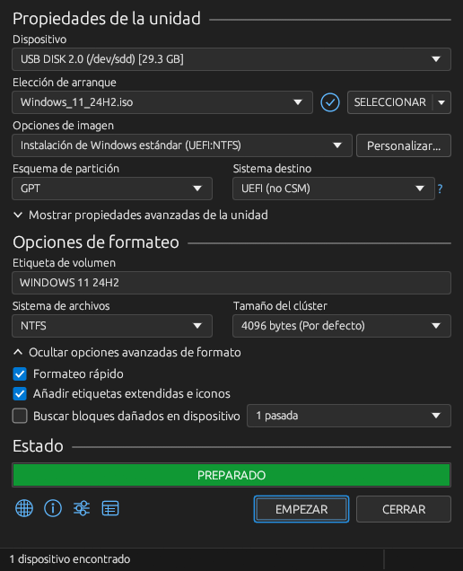
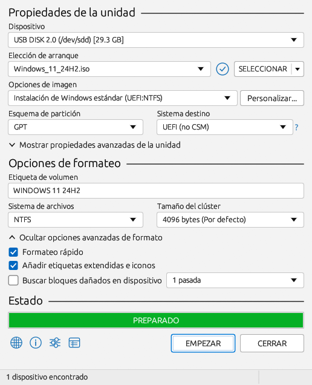

<p align="center">
  
</p>

<h1 align="center">Luxus</h1>

<p align="center">
  <strong>Creador nativo, rápido y universal de unidades USB autoarrancables para Linux</strong><br/>
  Escrito íntegramente en Rust · Windows 10/11 (UEFI:NTFS + desatendido) · Linux Live con persistencia · FreeDOS · VHD/IMG
</p>

<p align="center">
  
  
  
</p>

---

## Capturas de pantalla

| Modo oscuro (automático) | Modo claro |
| :---: | :---: |
|  |  |

---

## Características principales

### Medios de arranque de Windows 10/11 en Linux
- **Soporte nativo de UEFI:NTFS**: crea automáticamente una partición secundaria FAT ESP de 8 MiB con los controladores open-source `uefi-ntfs` + `EfiFs` (o un cargador autónomo offline con GRUB2 si no hay conexión a internet), permitiendo arrancar instaladores de Windows con archivos `install.wim` superiores a 4 GB en NTFS/exFAT/UDF desde equipos UEFI.
- **Cuadro de diálogo de Experiencia de Usuario de Windows** (`autounattend.xml` generado en Rust puro y exportable):
  - Elimina los requisitos de 4 GB+ de RAM, Arranque Seguro (Secure Boot) y TPM 2.0 (incluyendo marcador `appraiserres.dll` para actualizaciones).
  - Elimina el requisito de cuenta de Microsoft en línea (`BypassNRO`).
  - Crea una cuenta local de administrador personalizada (con validación de nombres reservados y saneamiento automático).
  - Aplica la configuración regional del usuario actual.
  - Desactiva preguntas de privacidad y telemetría inicial.
  - Desactiva el cifrado automático de dispositivos BitLocker (`PreventDeviceEncryption` y `TCGSecurityActivationDisabled`).
  - Opción para impedir el montaje automático de discos internos del equipo (`SanPolicy = 4`).
- **Extracción universal**: montaje loop con soporte automático `ntfs3`/`ntfs-3g` y respaldo automático mediante `7z`, `7zz` o `bsdtar`, más soporte de arranque Legacy BIOS en MBR con `ms-sys`.

### Escritura optimizada para Linux, FreeDOS e imágenes comprimidas
- **Motor de escritura en anillo sin realocaciones**: 3 búferes reutilizados configurables (1–16 MiB), `fdatasync` periódico cada 32 MiB y reintento automático de hasta 3 veces ante errores transitorios de E/S en puertos USB.
- **Detección inteligente de imágenes**: selecciona automáticamente el modo óptimo según el tipo de imagen (instalación Windows con UEFI:NTFS, escritura híbrida ISO para Linux, modo DD estricto para ISOs que lo requieran o extracción con soporte Legacy BIOS Syslinux + UEFI para ISOs no híbridas).
- **Descompresión en flujo sin archivos temporales**: escribe directamente a la unidad USB imágenes comprimidas `.gz`, `.xz`, `.zst`, `.bz2`, `.lzma` y `.zip`.
- **Partición persistente para Linux Live**: deslizador integrado para crear particiones `ext4` etiquetadas como `casper-rw` (Ubuntu, Linux Mint, Pop!_OS) o `persistence` con `/persistence.conf` (Debian, Kali, Parrot).
- **Modo FreeDOS**: prepara memorias FAT32 MBR listas para utilidades DOS de diagnóstico y actualización de BIOS.
- **Verificación SHA-256 posterior a la escritura**: relee la unidad y valida la integridad bit a bit.

### Respaldo, diagnóstico y utilidades de disco
- **Respaldo y restauración `.img` / `.vhd`**: clona cualquier memoria USB a una imagen cruda o a un disco virtual fijo Microsoft VHD (pie de página Connectix de 512 bytes generado en Rust puro), y permite restaurar archivos `.vhd` fijos descartando automáticamente el pie de página.
- **Limpieza rápida a ceros (`Alt+Z`)**: elimina firmas y tablas MBR/GPT/respaldo omitiendo bloques ya vacíos para reducir el desgaste de la memoria flash.
- **Expulsión segura**: desmonta y apaga la unidad USB de forma segura (`udisksctl power-off`).
- **Sumas de comprobación y comparador integrado**: calcula **MD5**, **SHA-1**, **SHA-256** y **SHA-512** en una sola pasada y valida al instante al pegar un hash esperado.
- **Prueba de bloques dañados y memorias USB falsas**: verificación de 1 a 4 pasadas (`0x55`, `0xAA`, `0xFF`, `0x00`) con detección de capacidad real falsa e aislamiento bloque por bloque.
- **Descarga directa de ISOs** desde el botón `SELECCIONAR / DESCARGAR` (Ubuntu, Debian, Arch, openSUSE, Alpine, FreeDOS, Mint, Kali, GParted, Clonezilla, Fedora y Windows 10/11).
- **Formateo completo**: **GPT** y **MBR**, **FAT32**, **Large FAT32**, **NTFS** (con compresión opcional), **UDF**, **exFAT**, **ext4**, **ext3** y **ext2**.

### Experiencia nativa en cualquier distribución Linux
- **Detección directa de USB sin subprocesos** (`/sys/block` + `/proc/mounts`) protegiendo siempre los discos del sistema.
- **Una sola solicitud de privilegios** (`pkexec`, `sudo` o `doas`) al iniciar una operación de escritura o formateo.
- **Configuración persistente** (`~/.config/luxus/config.json`), **modo oscuro automático** (GNOME, KDE Plasma, XFCE, Wayland/XDG Portal) y **8 idiomas** con detección automática del sistema (**Español, English, Português, Français, Deutsch, Italiano, Nederlands, Polski**).
- **Arrastrar y soltar** imágenes ISO/IMG/VHD/ZIP y atajos de teclado:
  - `F5`: actualizar dispositivos USB
  - `Ctrl+L`: abrir o cerrar el registro de actividad
  - `Alt+F`: mostrar u ocultar discos duros USB
  - `Alt+E`: activar modo dual UEFI/BIOS (MBR + arreglos para BIOS antiguas)
  - `Alt+D`: alternar tema claro/oscuro
  - `Alt+B`: activar o desactivar prueba de bloques dañados
  - `Alt+S`: respaldar la unidad USB seleccionada a `.vhd` o `.img`
  - `Alt+Z`: limpieza rápida de tabla de particiones

---

## Instalación

### Opción 1: Descargar el paquete compilado (Releases)

1. Descarga `luxus-0.1.0-beta.1-linux-x86_64.tar.gz` desde la sección de [Releases](https://github.com/AlanRGithub/luxus/releases).
2. Descomprime e instala el binario, el icono y el acceso directo:

```bash
tar -xzf luxus-0.1.0-beta.1-linux-x86_64.tar.gz
cd luxus-0.1.0-beta.1-linux-x86_64
sudo install -Dm755 luxus /usr/local/bin/luxus
install -Dm644 luxus.svg ~/.local/share/icons/hicolor/scalable/apps/luxus.svg
install -Dm644 luxus.png ~/.local/share/icons/hicolor/512x512/apps/luxus.png
install -Dm644 luxus.desktop ~/.local/share/applications/luxus.desktop
```

### Opción 2: Compilar desde el código fuente

#### Dependencias recomendadas del sistema

**Ubuntu / Debian / Linux Mint / Pop!_OS:**
```bash
sudo apt update
sudo apt install parted dosfstools ntfs-3g exfatprogs udftools e2fsprogs p7zip-full curl polkitd-pkla
```

**Fedora / RHEL / Rocky / AlmaLinux:**
```bash
sudo dnf install parted dosfstools ntfsprogs exfatprogs udftools e2fsprogs p7zip-plugins curl polkit grub2-efi-x64-modules
```

**Arch Linux / Manjaro / EndeavourOS:**
```bash
sudo pacman -S parted dosfstools ntfs-3g exfatprogs udftools e2fsprogs p7zip curl polkit
```

**openSUSE:**
```bash
sudo zypper install parted dosfstools ntfsprogs exfatprogs udftools e2fsprogs p7zip curl polkit
```

#### Compilación

```bash
git clone https://github.com/AlanRGithub/luxus.git
cd luxus
cargo build --release
./target/release/luxus
```

Instalación en el sistema tras compilar:
```bash
sudo install -Dm755 target/release/luxus /usr/local/bin/luxus
install -Dm644 assets/luxus.svg ~/.local/share/icons/hicolor/scalable/apps/luxus.svg
install -Dm644 assets/luxus.png ~/.local/share/icons/hicolor/512x512/apps/luxus.png
install -Dm644 packaging/luxus.desktop ~/.local/share/applications/luxus.desktop
```

---

## Opciones de línea de comandos

```bash
luxus                     # Detección automática de idioma y tema del sistema
luxus --locale en         # Fuerza idioma (es, en, pt, fr, de, it, nl, pl, auto)
luxus --theme dark        # Fuerza tema oscuro
luxus --theme light       # Fuerza tema claro
```

## Pruebas

```bash
cargo test
```

## Licencia

Distribuido bajo licencia **GPL-3.0-or-later**. Consulta el archivo [LICENSE](LICENSE).
